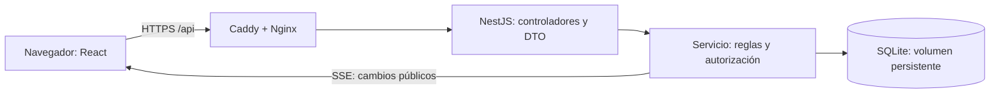

# Campus - Mini red social estudiantil

Aplicación para compartir publicaciones de texto, dar me gusta, comentar y seguir a otros estudiantes. Incluye feed general, feed de personas seguidas, perfiles editables y actualizaciones de interfaz en tiempo real mediante Server-Sent Events (SSE).

## Estado de la entrega

Código implementado. El despliegue público queda pendiente hasta disponer de alojamiento. **No entregar el PDF como versión final mientras falten URLs públicas funcionales y capturas de producción.**

Repositorio: https://github.com/Ferotuc/campus-social (privado; para evaluación se debe conceder acceso al docente o cambiar su visibilidad).

## Tecnologías

- Frontend: React, TypeScript y Vite; HTML semántico y CSS responsive.
- Backend: NestJS, TypeScript, validación con class-validator y Swagger/OpenAPI.
- Base de datos: SQLite relacional mediante `node:sqlite`, con claves foráneas, índices y migraciones SQL versionadas.
- Tiempo real: SSE; el servidor emite cambios y los clientes consultan nuevamente los datos confirmados.
- Producción: contenedores independientes de frontend/backend, Nginx y Caddy con HTTPS; volumen persistente para SQLite.

SQLite satisface el requisito de base de datos relacional; PostgreSQL y MySQL figuran como ejemplos en el enunciado, no como opciones exclusivas. Si el docente exige una de esas tecnologías, será necesario adaptar la capa de datos antes de entregar. SSR/prerender aparece como recomendado: esta versión usa renderizado en el cliente.

## Arquitectura



Frontend y backend son procesos y contenedores distintos. Comparten dominio a través del proxy para evitar problemas de cookies de terceros. API REST pública bajo `/api`; el servicio no depende de objetos HTTP.

## Ejecutar en Windows

Requisito: Node.js 24 LTS y npm. Desde la raíz del repositorio:

```powershell
npm ci
Copy-Item backend/.env.example backend/.env
Copy-Item frontend/.env.example frontend/.env
npm run build
npm test
npm run dev:api
```

En otra terminal:

```powershell
npm run dev:web
```

Abrir `http://localhost:5173`. Backend: `http://localhost:3001/api/health`. Swagger: `http://localhost:3001/api/docs`. OpenAPI JSON: `http://localhost:3001/api/openapi.json`.

`dev:api` compila al iniciar y observa el JavaScript generado. Tras editar TypeScript, ejecutar `npm --prefix backend run build` o reiniciar el comando. No se crean usuarios ni publicaciones ficticios automáticamente: registra dos cuentas para probar interacciones.

## Variables de entorno

Backend: `PORT`, `FRONTEND_ORIGIN` (orígenes exactos separados por coma), `DATABASE_PATH`, `NODE_ENV`, `TRUST_PROXY_HOPS` (0 local; 2 con los proxies de compose). `COOKIE_CROSS_SITE=true` solo para frontend/backend en sitios distintos bajo HTTPS; las políticas de cookies de terceros pueden impedir esa configuración.

Frontend: `VITE_API_URL`, dirección sin `/api`. En compose se compila como cadena vacía para usar `/api` en el mismo dominio. Los cambios de esta variable requieren recompilar.

No se usa un secreto JWT: las sesiones son tokens aleatorios de 256 bits, conservados en cookie HttpOnly; solo se guarda su hash SHA-256 en la base de datos. `.env` y archivos de datos se excluyen de Git. Contraseñas derivadas con scrypt y salt individual; sesiones con vencimiento a siete días y revocación al cerrar sesión.

## Migraciones y datos

`backend/migrations/001_initial.sql` crea usuarios, sesiones, publicaciones, likes, comentarios y relaciones de seguimiento. La API ejecuta cada migración pendiente en una transacción y registra su nombre en `schema_migrations`. Reiniciar no elimina los datos ni repite migraciones aplicadas.

No borrar el volumen `campus-data` al actualizar. Para respaldar una instancia pequeña, detener el backend y copiar `/data/campus.db` desde el volumen; guardar los respaldos fuera del servidor. No ejecutar múltiples réplicas del backend con este diseño: SSE es local al proceso y SQLite requiere un disco persistente compartido con cautela.

## API y permisos

| Grupo | Operaciones |
|---|---|
| Autenticación | POST `/auth/register`, `/auth/login`, `/auth/logout`; GET `/auth/me` |
| Usuarios | GET `/users`, `/users/:id`; PATCH `/users/me` |
| Seguimiento | PUT y DELETE `/users/:id/follow` |
| Publicaciones | GET y POST `/posts`; GET y DELETE `/posts/:id` |
| Likes | PUT y DELETE `/posts/:id/like` |
| Comentarios | GET y POST `/posts/:id/comments` |
| Tiempo real | GET `/events` con `text/event-stream` |

Prefijo común: `/api`. Feed paginado: `?page=1&mode=all`, `mode=following` o `author=ID`. Las lecturas son públicas; las mutaciones requieren sesión, salvo registro/login. Solo el autor puede borrar su publicación o modificar su perfil. Likes y seguimientos son idempotentes y poseen claves compuestas únicas. No se permite seguirse a uno mismo.

Validación global rechaza propiedades desconocidas; consultas SQL parametrizadas; comprobación de Origin para mutaciones con cookies; CORS explícito; límite de 30 intentos de autenticación por IP cada 15 minutos. SSE expone solo eventos de invalidación públicos, sin contraseñas, correos ni tokens. Al reconectar, el frontend recarga el feed para recuperar cambios perdidos.

## Desplegar en VPS con dominio

1. Tener un VPS Linux con Docker Compose, dominio apuntando a su IP y puertos 80/443 disponibles.
2. Copiar el repositorio al servidor. Copiar `.env.example` a `.env` y definir `SITE_HOST=campus.tu-dominio.com` y `PUBLIC_ORIGIN=https://campus.tu-dominio.com` con el dominio real.
3. Ejecutar `docker compose up -d --build`. Caddy obtiene el certificado HTTPS para un dominio público válido.
4. Revisar `docker compose logs backend gateway` y probar registro, login, publicaciones y tiempo real desde dos ventanas.
5. Registrar los enlaces reales: frontend `https://DOMINIO`, backend `https://DOMINIO/api/health`, Swagger `https://DOMINIO/api/docs`.

No registrar cookies seguras sobre HTTP de producción. `localhost` con Caddy utiliza certificado local que debe confiarse; para trabajar localmente es más sencillo usar los comandos npm anteriores.

Para Render/Railway se requiere disco persistente para la base de datos y un único proceso backend. No usar almacenamiento efímero ni asumir que una oferta gratuita incluye persistencia. Revisar la guía `DESPLIEGUE.md` antes de contratar un plan.

## Pruebas

`npm test` verifica un servidor real con base temporal: registro/login, rechazo de datos inválidos y campos extra, duplicados 409, autorización 401/403, likes idempotentes, comentarios, seguimiento, perfiles, 404, CORS/CSRF, OpenAPI, evento SSE, persistencia de datos/sesiones tras reinicio y revocación de sesión. Las bases temporales se eliminan al terminar.

## Lista de entrega

- [ ] Frontend y backend publicados y probados desde internet.
- [ ] Migraciones y volumen persistente comprobados en producción.
- [ ] Dos cuentas reales de prueba para mostrar interacciones/SSE.
- [ ] README con URLs públicas definitivas.
- [ ] PDF con nombre, carné, arquitectura, tecnologías, capturas y enlaces funcionales.
- [ ] PDF subido a Canvas antes del 31 de octubre de 2026, 23:59 (Guatemala).
